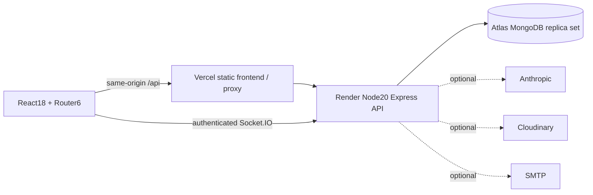

# ReplateAI

Share surplus food between restaurants and NGOs, with reviewed AI assistance, matching and measured impact.

**Working synthetic demo:** https://replate-ai-sigma.vercel.app/  
**API:** https://replate-api.onrender.com/  
**Repository:** https://github.com/chethan-r30/replate-ai

## Status and demo use

Phases0-9 are implemented and verified. Phase10 documents the final checks below. The live restaurant-post -> NGO-request -> restaurant-approval -> code-confirmed-pickup flow passed2026-10-29. All food, organizations, addresses and impact are synthetic. Nothing is available for actual collection.

This is the accepted **free demo, not a production-ready public food service**. The API can take about a minute to wake; reminders pause while it sleeps. Anthropic, Cloudinary and SMTP keys are absent. Manual entry, numeric forecasts and rule-based matching work; real signup verification/reset email and image upload need configured services. Do not enter personal data or use personal passwords.

Demo identities: restaurant1@demo.replate.invalid through restaurant3; ngo1@demo.replate.invalid through ngo3. The owner has the shared demo-only password in the private vault item `ReplateAI synthetic demo accounts`. Do not publish it or the admin credential. Seeded pickup windows expire naturally; past demo food is not kept artificially available. New synthetic listings can be posted to repeat the workflow.

## Features

- Rotating refresh sessions, email/password authentication, role and ownership checks, organization review and audit records.
- Geo/list search, dietary/category/pickup filters, restaurant listings, NGO claims, six-digit handover and feedback.
- Statistical forecasts with local-calendar seasonality, capacity/reliability/distance/time matching, reviewed listing parser and safe missing-key fallbacks.
- Role dashboards, charts, map, private realtime hints with durable notifications, public impact, dark mode and offline app shell.
- Transactional claims/history, privacy erasure, validation, rate limits, security headers and safe image handling.

## Architecture



JavaScript ES2022/JSX throughout. React18, Vite, Tailwind, React Router6, TanStack Query, Zustand, React Hook Form/Zod, Leaflet/OSM, Recharts, Socket.IO and PWA shell. Node20, Express, Mongoose, Zod, pino, Helmet, cron and Vitest/Supertest/Playwright.

## Local setup

Use Node20 (`nvm use`) and npm. The first disposable MongoDB launch downloads its test binary and needs network access.

```sh
git clone https://github.com/chethan-r30/replate-ai.git
cd replate-ai
npm install
cp server/.env.example server/.env
cp client/.env.example client/.env
npm run dev
```

Open http://localhost:5173. `npm run dev` deliberately uses a disposable local replica set and ephemeral JWT keys. Data/sessions disappear after restart; no real service integration is simulated as successful. Ignored `.env` files keep the same placeholder keys as examples.

For persistent startup, fill MongoDB/JWT keys and run `npm start -w server`. Invalid required settings fail clearly. For Docker, install Docker/Compose, replace JWT placeholders, then `docker compose up --build`. Mongo stays private to the local network; repository CI builds both non-root images and verifies readiness.

## Configuration

Never commit real values. Full key list: [server/.env.example](server/.env.example), [client/.env.example](client/.env.example).

| Keys                                                             | Purpose                                                       |
| ---------------------------------------------------------------- | ------------------------------------------------------------- |
| NODE_ENV, PORT, CLIENT_URL                                       | Runtime and exact allowed browser origin; HTTPS in production |
| MONGODB_URI                                                      | Replica-set database; required outside disposable sandbox     |
| JWT_ACCESS_SECRET, JWT_REFRESH_SECRET                            | Separate random32+character secrets                           |
| JWT_ACCESS_EXPIRES, JWT_REFRESH_EXPIRES                          | Fixed15m and7d                                                |
| COOKIE_DOMAIN                                                    | Legacy placeholder; refresh cookie stays host-only            |
| ANTHROPIC_API_KEY, ANTHROPIC_MODEL                               | Optional reviewed parser/prose;10s timeout and fallback       |
| CLOUDINARY_CLOUD_NAME, CLOUDINARY_API_KEY, CLOUDINARY_API_SECRET | Optional image upload; unavailable without keys               |
| SMTP_HOST, SMTP_PORT, SMTP_USER, SMTP_PASS, EMAIL_FROM           | Verification/reset/notification email; no false delivery      |
| RATE_LIMIT_WINDOW_MS, RATE_LIMIT_MAX, AI_RATE_LIMIT_PER_HOUR     | Global and AI limits; login also separately limited           |
| REDIS_URL                                                        | Optional shared cache                                         |
| GOOGLE_CLIENT_ID, GOOGLE_CLIENT_SECRET                           | Reserved placeholders; optional OAuth not implemented         |
| VITE_API_URL, VITE_SOCKET_URL                                    | Public API/socket locations; never secrets                    |
| VITE_DEMO_MODE                                                   | Visible synthetic-demo warning                                |

`scripts/generate-secrets.js` prints random JWT values locally. Keep its output private. Deployment-only seed settings: MONGODB_URI, SEED_PASSWORD and explicit SEED_ALLOW_REMOTE=true for an intended remote demo. See [DEPLOYMENT.md](DEPLOYMENT.md).

## Commands and verification

| Command                             | Purpose                                                   |
| ----------------------------------- | --------------------------------------------------------- |
| npm run dev                         | Local disposable API/web sandbox                          |
| npm run lint / npm run format:check | Source checks                                             |
| npm test / npm run test:coverage    | Unit/integration/component suite and coverage gates       |
| npm run build                       | Both workspace builds                                     |
| npm run test:e2e                    | Desktop/mobile signup, approval, post and handover        |
| npm run test:load                   | Three200-distinct-user disposable trials; p95<300ms gate  |
| npm run test:lighthouse             | Built frontend Lighthouse/axe checks                      |
| npm run analyze                     | Bundle visualizer                                         |
| npm run seed                        | Guarded synthetic demo, never overwrites an existing seed |

[Requirement reconciliation](ACCEPTANCE.md), [TEST_REPORT.md](TEST_REPORT.md), [PERFORMANCE.md](PERFORMANCE.md), [SECURITY.md](SECURITY.md), [ARCHITECTURE.md](ARCHITECTURE.md), [API.md](API.md), [DEPLOYMENT.md](DEPLOYMENT.md), [phase evidence](docs/PROGRESS.md).

API reference UI: https://replate-api.onrender.com/api/docs . Local: http://localhost:5000/api/docs.

## Screenshots

Placeholder: desktop restaurant dashboard after synthetic handover.  
Placeholder: mobile NGO search/map and pickup flow.  
Inspected acceptance screenshots accompanied the private handoff; replace placeholders with sanitized images before publishing a promotional page.

## Roadmap and limits

Configure real external services and validate delivery/uploads, choose an approved always-on scheduler/hosting arrangement, establish backup/retention/food-safety operations, load-test the chosen production topology, and complete an independent security review before real use. Optional OAuth and Sentry are not implemented. PWA offline shell does not permit offline claims. Shared free hosting is not certified for200concurrent users; the load target is measured in disposable CI.

Work through feature PRs into develop and checked release PRs into protected main. See [CONTRIBUTING.md](CONTRIBUTING.md). MIT license: [LICENSE](LICENSE).
